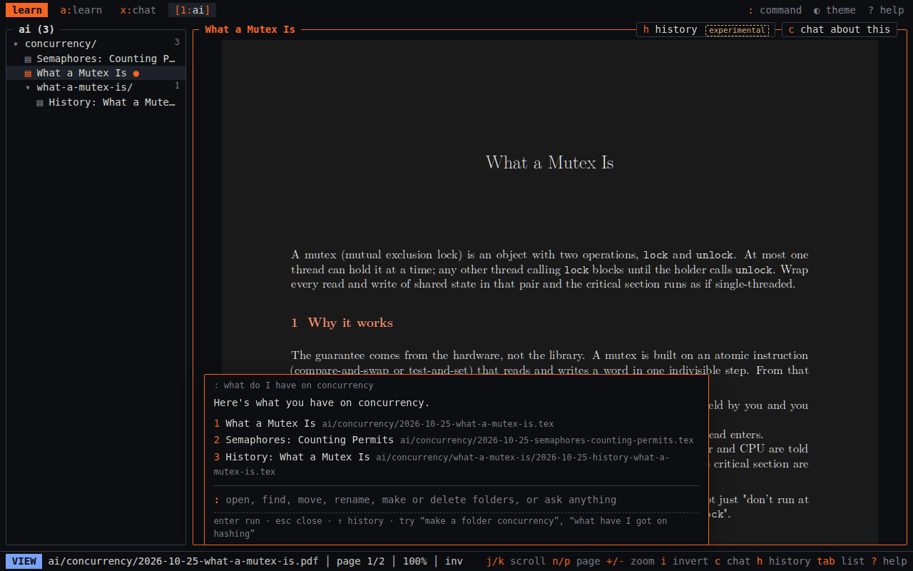
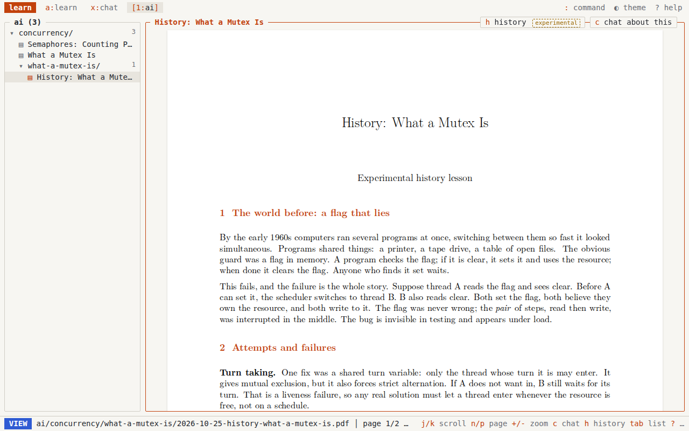

# dum-learn

A small, keyboard-first place to learn things fast when you're stuck. Type what
you don't get and you get back a short, typeset **LaTeX PDF explainer** (1 to 3
pages) in the same style as the rest of your notes. Then read it, chat about it,
branch to what it builds on, or ask how the idea came to be.





## Features

- **Prompt to PDF explainer.** "explain why a hash map is O(1)" becomes a
  1 to 3 page LaTeX document (compiled with tectonic, auto-fixed if it doesn't
  compile) filed under a topic.
- **Chat beside the PDF.** Press `c` while reading to open a chat panel next
  to the file: PDF on the left, chat on the right, on the same page. The file
  is pinned as context and its last chat resumes. The page you're on and any
  text you select in the PDF go with each question. Drag the divider to resize;
  `c` or the edge tab collapses it, and the width and open state are
  remembered. On a phone it's a bottom sheet. `esc` in the box takes you back to
  the page. Works for PDFs and code/text files.
- **One AI command box** (`:` or `/`) for the file side, in plain English:
  make, rename, or delete folders, move or rename files, retag topics, open
  or find files, and write a new explainer into a folder. The model can only
  return actions from a short whitelist. The server re-checks every path:
  inside the content root, no `..`, no symlinks, allowed extensions only.
  Moves apply right away and `u` undoes them. Deletes and overwrites ask you
  to confirm first, then go to a trash folder you can undo from.
- **Folder tree.** A collapsible tree you can drive with the keyboard.
- **Prerequisite branching.** Before writing, a quick check asks whether the
  topic builds on something you haven't covered ("Raft builds on state machine
  replication. Branch off first?"). You can say yes, skip, or pick another
  prerequisite, up to 3 levels deep. A breadcrumb shows where you are, and
  `b` takes you back up to the explainer you branched from.
- **History lessons (experimental).** Still don't get it? Press `h`, or tell
  the command box "I don't get X". You get a 1 to 2 page history of the
  problem the idea solved: the earlier attempts and why they failed, the key
  insight, what it unlocked, a dated timeline, and one primary source. Each is
  saved as a child of the explainer it came from. The prompt asks for real
  names and dates only, hedged when unsure, but check anything you plan to
  rely on.
- **Time bar chart.** See time spent learning, by topic or by week. Nothing
  else: no streaks and no quizzes.
- **Light and dark** themes (`T`). PDFs are never inverted unless you press `i`.
- Reading is public and read-only. Chat, learn, and commands sit behind a
  passcode. The API key stays on the server, and there are daily caps and
  per-minute rate limits.

## Keys

| key | does |
| --- | --- |
| `1`-`9` | switch tab (top-level folder) |
| `j` `k` / arrows | move in the tree, or scroll the open file |
| `enter` `l` | open a file, or fold/unfold a folder |
| `h` / `←` | tree: fold, or go up a folder · viewer: `h` is a history lesson, `←`/`tab` go back to the tree |
| `n` `p` · `g` `G` · `+` `-` `0` | page · first/last · zoom |
| `i` · `s` · `d` | invert PDF · view LaTeX source · download |
| `c` | open / collapse the chat beside the file |
| `:` or `/` | command box (`y` confirm, `n` cancel, `u` undo, `1`-`9` open a result) |
| `a` | learn: type what you're stuck on |
| `b` | back up from a prerequisite explainer |
| `t` | time chart (`w` toggles topic/week) |
| `T` · `?` | theme · help |

## Setup

You need Node 20+, [tectonic](https://tectonic-typesetting.github.io/), poppler
(`pdfinfo`) and rsync. You also need a DeepSeek API key, or any
OpenAI-compatible endpoint via `LEARN_AI_API` and `LEARN_AI_MODEL`.

```sh
git clone https://github.com/hub-ry/dum-learn ~/code/dum-learn && cd ~/code/dum-learn
npm ci

# content: one top-level folder per tab; learn.sty at the root
mkdir -p ~/learn && cp -r examples/content/* ~/learn/

# secrets and config live outside the repo
mkdir -p ~/.config/learn && chmod 700 ~/.config/learn
cp .env.example ~/.config/learn/env && chmod 600 ~/.config/learn/env   # set DEEPSEEK_API_KEY, LEARN_ORIGIN
(umask 077; printf '%s\n' 'choose-a-passcode' > ~/.config/learn/passcode)

# build + run locally (the AI server also serves the static site)
LEARN_PUBLISH_DIR=$PWD/site ./deploy/publish.sh
set -a; . ~/.config/learn/env; set +a
LEARN_ROOT=$PWD/site LEARN_PUBLISH_DIR=$PWD/site node ai/server.mjs   # http://127.0.0.1:8075
```

Each `.tex` file under the content root should start with
`\documentclass[11pt]{article}` `\usepackage{learn}`. The build compiles every
one to a PDF. Code and text files are shown with syntax highlighting.

## Deploy (generic)

- `server.mjs` is a dependency-free, read-only static server on
  `127.0.0.1:8072`. `deploy/install.sh` installs it as a system service and
  needs sudo.
- `ai/server.mjs` is the backend for `/api/*` on `127.0.0.1:8075`. To run it as
  a user service, copy `deploy/learn-ai.service` to
  `~/.config/systemd/user/`, run `loginctl enable-linger $USER`, then
  `systemctl --user enable --now learn-ai`.
- Put a reverse proxy (cloudflared, caddy, nginx) on one hostname. Send
  `/api/*` to 8075 and everything else to 8072, and set `LEARN_ORIGIN` to that
  hostname.
- `deploy/publish.sh` rebuilds and rsyncs the site. The backend runs it after
  every change it makes, and a LaTeX error stops the publish.

Your data (sessions, chats, time, lessons, undo log, trash) lives in
`LEARN_DATA`, outside the repo.

## Layout

```
ai/        server.mjs (API), prompts.mjs, files.mjs (path rules), tex.mjs, llm.mjs
web/       the site (tree, viewer, command box, learn view, time chart)
build.mjs  content root -> static site (PDFs, highlighted code, index)
deploy/    publish, systemd units, install
examples/  learn.sty and a few sample explainers
```

## License

MIT, (c) 2026 Ryan Hubbart. The teaching prompts adapt `teach` from
[mattpocock/skills](https://github.com/mattpocock/skills) (MIT, Matt Pocock)
and `teach` from [cursor/plugins](https://github.com/cursor/plugins) pstack
(MIT, Lauren Tan). See [LICENSE](LICENSE).
